<p align="center"><a href="README.md">Read in English</a></p>

<p align="center">
  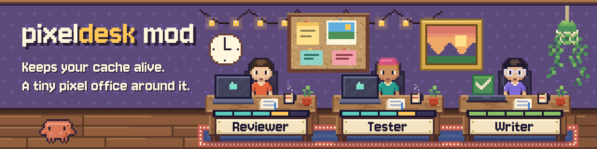
</p>

<h3 align="center">Une interface pixel art pour suivre tes agents Claude en direct.</h3>

<p align="center">Agents, plan et limites à l'écran. Un cache gardé en vie pour dépenser moins de tokens.</p>

<p align="center">
  
  
  
  
</p>

<p align="center">
  <a href="#comment-installer-pixeldesk-mod"><b>Installer</b></a> &nbsp;·&nbsp;
  <a href="#ce-que-pixeldesk-mod-affiche-à-lécran"><b>L'interface</b></a> &nbsp;·&nbsp;
  <a href="#la-vue-globale--toutes-tes-conversations-dun-coup-dœil"><b>La vue globale</b></a> &nbsp;·&nbsp;
  <a href="#fait-pour-téconomiser-des-tokens"><b>Économiser des tokens</b></a> &nbsp;·&nbsp;
  <a href="#6-thèmes-disponibles-pour-ton-pixeldesk"><b>Les thèmes</b></a> &nbsp;·&nbsp;
  <a href="#commandes"><b>Commandes</b></a>
</p>

<p align="center">
  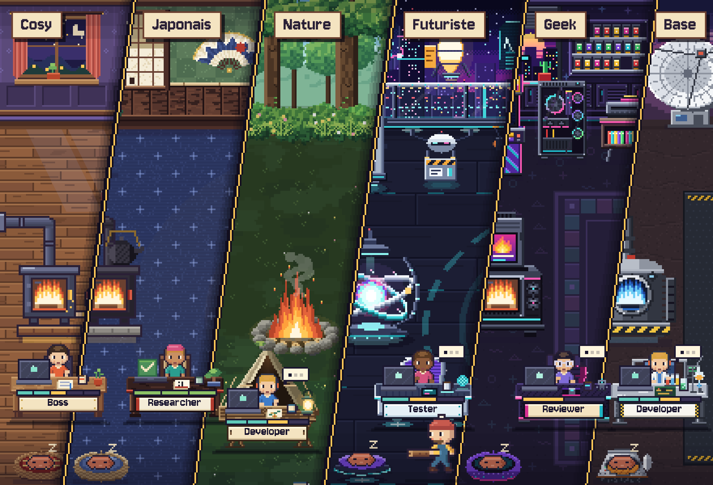
</p>

<p align="center"><sub>Les six thèmes réunis dans un montage, à partir des vrais dessins du mod.</sub></p>

PixelDesk Mod ajoute à Claude Code une interface en pixel art, sous la forme d'un petit bureau.

Chaque agent a son bureau, ton plan est au mur, tes limites restent visibles. Tout s'affiche en direct, à côté de ta conversation.

L'interface n'est que la partie visible. Le mod garde aussi ton cache en vie et change de conversation au bon moment, pour réduire ta consommation de tokens.

Gratuit et open source, sous licence MIT.

## Comment installer PixelDesk Mod

**Dans l'application de bureau Claude, ouvre l'onglet Code et colle cette ligne dans la conversation :**

```
Install the PixelDesk Mod plugin. Run: claude plugin install pixeldesk --marketplace Mats-TH/pixeldesk-mod (if claude is not found, use the path in the CLAUDE_CODE_EXECPATH environment variable instead).
```

Utilise le bouton de copie, car la ligne dépasse du cadre. Claude lance l'installation pour toi : autorise-la quand il te le demande.

Ouvre ensuite une nouvelle conversation dans l'onglet Code. Le mod est actif.

| Où tu es | Quoi faire |
| --- | --- |
| **Dans l'onglet Code** | Colle la ligne ci-dessus. Pas besoin de terminal. |
| **Dans une conversation normale** | Passe par l'onglet Code. Une conversation peut répondre que le plugin est installé, mais cela n'atteint pas l'onglet Code, où tourne le mod. Va dans l'onglet Code, puis colle la ligne. |
| **Dans un terminal** | Lance la commande donnée dans le bloc ci-dessous. |

<details>
<summary><b>Les autres façons d'installer</b></summary>

<br>

**Depuis n'importe quel terminal :**

```bash
claude plugin install pixeldesk --marketplace Mats-TH/pixeldesk-mod
```

**Avec les boutons de l'application :** clique sur **+** à côté de la zone de saisie, puis **Plugins**, puis **Add marketplace**. Colle `Mats-TH/pixeldesk-mod`, puis clique sur **Add plugin**.

**Depuis une session terminal déjà ouverte :**

```
/plugin install pixeldesk --marketplace Mats-TH/pixeldesk-mod
```

Réponds `y` pour ajouter la marketplace, puis choisis une portée.

**Pour imposer une langue dès l'installation :**

```bash
claude plugin install pixeldesk --marketplace Mats-TH/pixeldesk-mod --config language=fr
```

Il te faut Git sur ta machine : le plugin est récupéré depuis GitHub.

</details>

## Ce que PixelDesk Mod affiche à l'écran

<p align="center">
  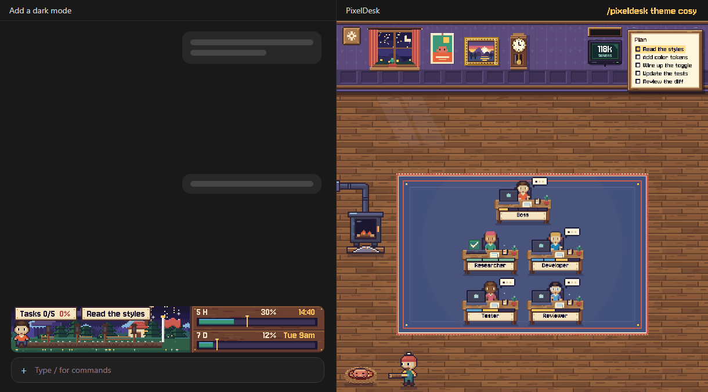
</p>

<p align="center"><sub>Une maquette, dessinée par le code du mod. La barre, la pièce et le gardien sont les vrais dessins.</sub></p>

<table>
  <tr>
    <td width="33%" valign="top">
      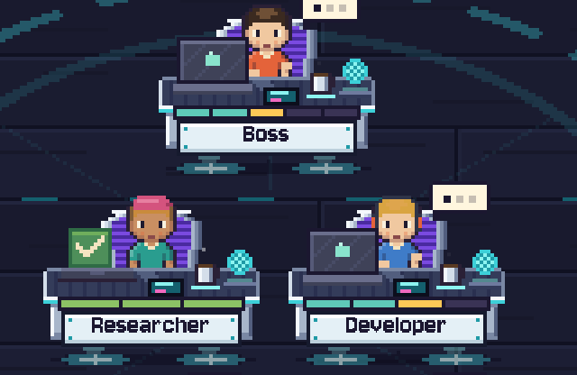
      <br><b>Un bureau pour chaque agent</b>
      <br>Chaque sous-agent s'installe à son bureau, en direct. Survole-le pour lire ce qu'il fait. Ta conversation principale est le Patron.
    </td>
    <td width="33%" valign="top">
      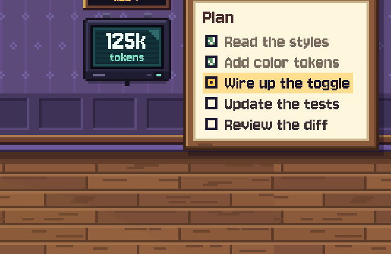
      <br><b>Ton plan affiché au mur</b>
      <br>Claude annonce ses étapes, et tu suis où il en est. Survole une étape pour son détail et qui s'en charge.
    </td>
    <td width="33%" valign="top">
      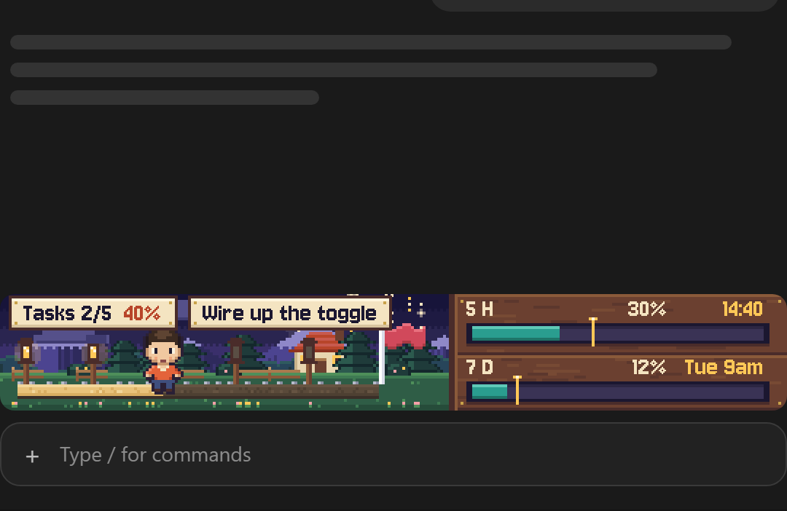
      <br><b>Tes limites toujours visibles</b>
      <br>Une barre au-dessus de la saisie montre ta progression et tes limites de 5 heures et de la semaine.
    </td>
  </tr>
  <tr>
    <td width="33%" valign="top">
      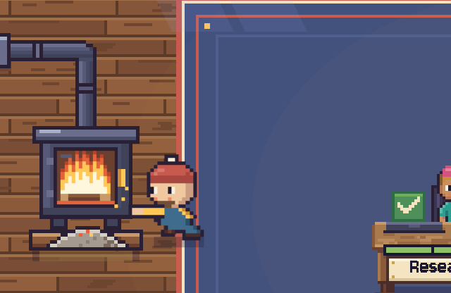
      <br><b>Un feu qui montre ton cache</b>
      <br>Le feu baisse quand ton cache va expirer. Un gardien apporte une bûche pour le garder en vie.
    </td>
    <td width="33%" valign="top">
      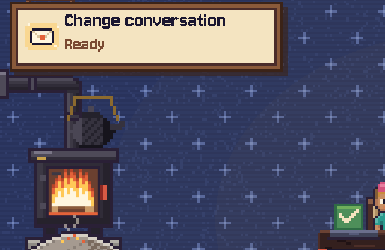
      <br><b>Une cendre qui montre le remplissage</b>
      <br>Le tas grossit avec ta conversation. Quand il est plein, le mod prend le relais.
    </td>
    <td width="33%" valign="top">
      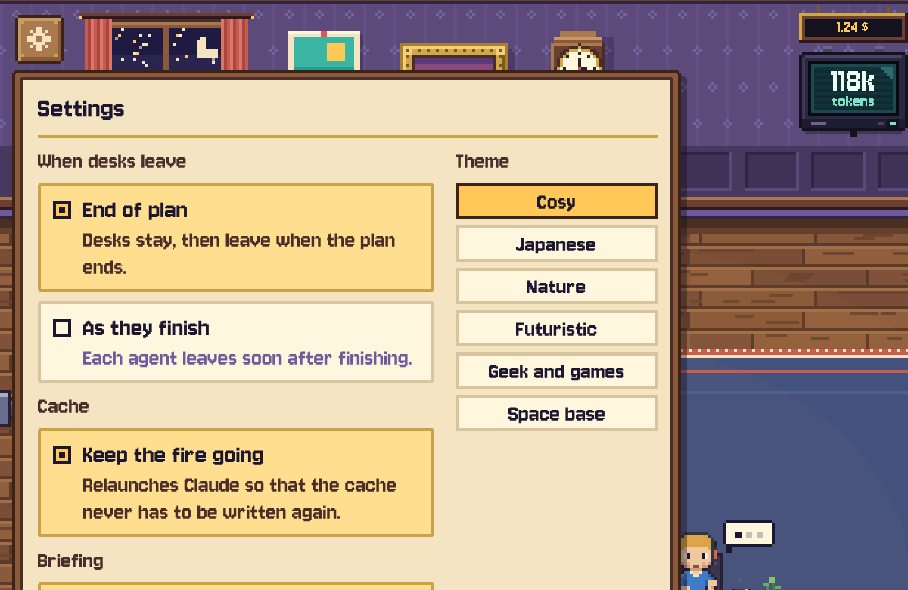
      <br><b>Un panneau de réglages</b>
      <br>Le bouton sur le mur ouvre les Réglages : thème, relances, compactage.
    </td>
  </tr>
</table>

### Autres fonctionnalités

- **Une carte sur le feu.** Survole-le pour voir le temps restant et le remplissage exact.
- **Des bureaux qui se rangent seuls.** Les agents finis partent d'eux-mêmes.
- **Tokens et coût affichés** sur le mur de la pièce.
- **Un crabe** qui vit dans la pièce.
- **Français et anglais.** Le mod choisit tout seul.
- **Une version terminal.** Plus simple, en texte, sans le pixel art.

## La vue globale : toutes tes conversations d'un coup d'œil

<p align="center">
  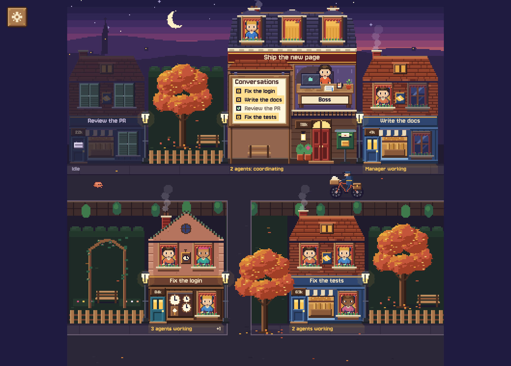
</p>

Dès que ta conversation principale en lance d'autres, PixelDesk Mod change d'interface.

La pièce laisse place à une vue globale, faite pour le Patron : toutes ses sous-conversations sur une seule image. Elle s'ouvre toute seule.

- **Une pièce par sous-conversation**, avec son nom et son Manager.
- **Son état, écrit dessous :** combien d'agents travaillent, ou si le Manager travaille.
- **Une conversation au repos s'assombrit**, pour repérer celles qui travaillent.
- **Ses tokens** affichés à côté de son nom.
- **La liste de toutes tes conversations** au mur du Patron, cochée au fil de l'eau.
- **Une carte au survol** pour lire où en est chacune.

## Fait pour t'économiser des tokens

PixelDesk Mod agit sur deux choses : le cache, et la taille de ta conversation. Voici le cache.

### Qu'est-ce que le cache de Claude ?

À chaque message, Claude relit toute ta conversation. Pour limiter ce coût, il en garde une copie dans un cache.

Tant que ce cache est valide, la relecture coûte [une fraction du prix normal](https://platform.claude.com/docs/en/about-claude/pricing#prompt-caching). Une fois qu'il a expiré, ton message suivant doit tout relire au prix fort.

Plus la conversation est longue, plus l'écart est important.

### Cache de 5 minutes ou d'une heure : lequel as-tu ?

La durée dépend de ton compte, pas de l'endroit où tu travailles, selon [la documentation de Claude Code](https://code.claude.com/docs/en/prompt-caching) :

| Ton compte | Conversation principale | Sous-agents |
| --- | --- | --- |
| Abonnement Claude, dans ton quota inclus | 1 heure | 5 minutes |
| Abonnement Claude, en crédits d'usage | 5 minutes | 5 minutes |
| Clé API, Bedrock ou Vertex | 5 minutes | 5 minutes |

Chaque message relance ce délai. Le cache reste donc valide tant que tu travailles.

Il expire quand tu t'absentes : une pause, une réunion, un déjeuner.

### Comment PixelDesk Mod garde ton cache en vie

Le mod surveille le cache de ta conversation principale. Il détecte sa durée tout seul, sans réglage.

Juste avant l'expiration, il envoie à Claude une ligne très courte. Claude relit depuis le cache, et le délai repart de zéro. C'est une relance.

À ton retour, le cache est toujours valide, et ton message suivant coûte moins cher.

<p align="center">
  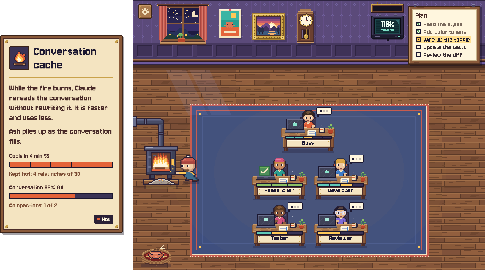
</p>

### Ce que coûtent les relances

Une relance consomme aussi des tokens, et elle compte dans tes limites.

Elle est rentable si tu reviens. Sinon, elle a été dépensée pour rien. C'est pourquoi le mod s'arrête seul au bout d'un moment sur une conversation inactive.

L'économie dépend de la taille de ta conversation et de ta façon de travailler. Elle n'a pas été mesurée pour le public, donc aucun chiffre ici.

Les relances se désactivent dans les Réglages.

## Comment PixelDesk Mod évite de perdre ton contexte

Le contexte, c'est tout ce que Claude a en tête dans ta conversation. Sa taille est limitée.

Quand il se remplit, Claude Code compacte : il remplace les anciens messages par un résumé. Cela libère de la place, mais des détails disparaissent à chaque fois. Plus on compacte, plus le contexte s'appauvrit.

PixelDesk Mod change donc de conversation au bon moment, pour préserver ton contexte.

**Par défaut, le mod compacte deux fois, puis change de conversation :**

1. Ta conversation atteint 80 % de sa limite de contexte : le tas de cendre est plein.
2. Le mod compacte une première fois, et tu continues.
3. Elle revient à 80 % : il compacte une deuxième fois.
4. Elle revient encore à 80 % : il ouvre une nouvelle conversation, avec un briefing déjà lu.

Si Claude Code compacte de lui-même entre-temps, cela compte pour une des deux fois.

**C'est aussi une économie de tokens.** Une conversation neuve est courte, donc chaque message a moins à relire.

**Le contexte utile est conservé.** Avant chaque compactage, le mod note les fichiers, les décisions et tes demandes. Le briefing part de ces notes, pas d'un résumé de résumé.

**Le travail en cours n'est pas interrompu.** Le mod attend la fin du tour et la fin de tes agents. La nouvelle conversation s'ouvre dans le même dossier.

Ce comportement se change dans les Réglages.

## 6 thèmes disponibles pour ton PixelDesk

Chaque thème a son décor, ses bureaux, son poêle et sa vue globale.

Pour en changer, ouvre les Réglages et choisis-en un dans la colonne Thème.

Chaque thème est présenté en deux images : la pièce, puis la vue globale.

### Cosy

<p align="center">
  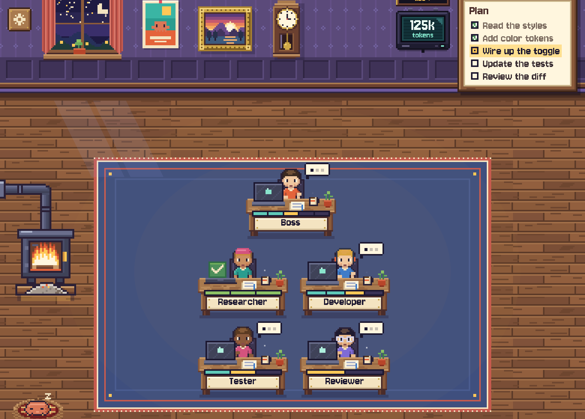
  
</p>

### Japonais

<p align="center">
  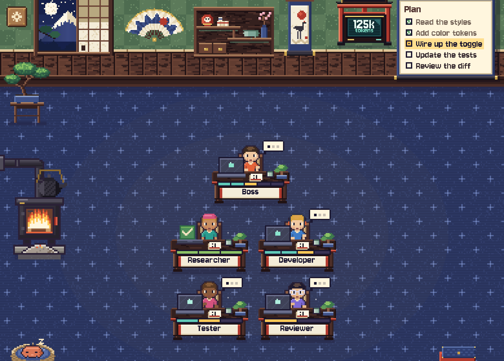
  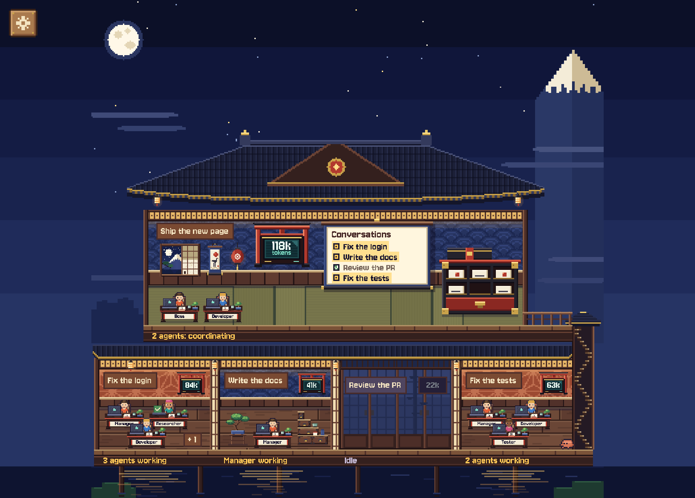
</p>

### Nature

<p align="center">
  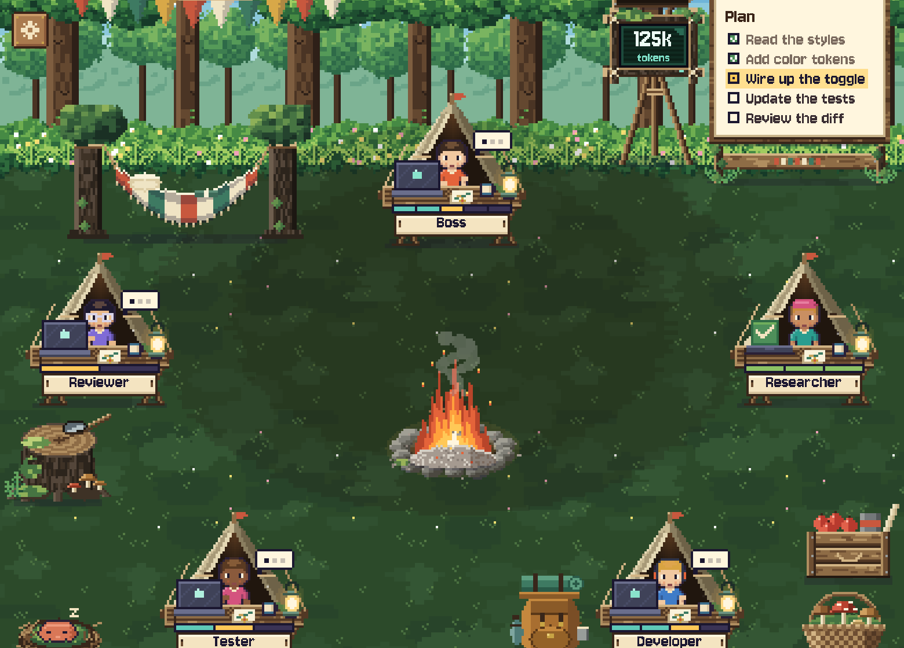
  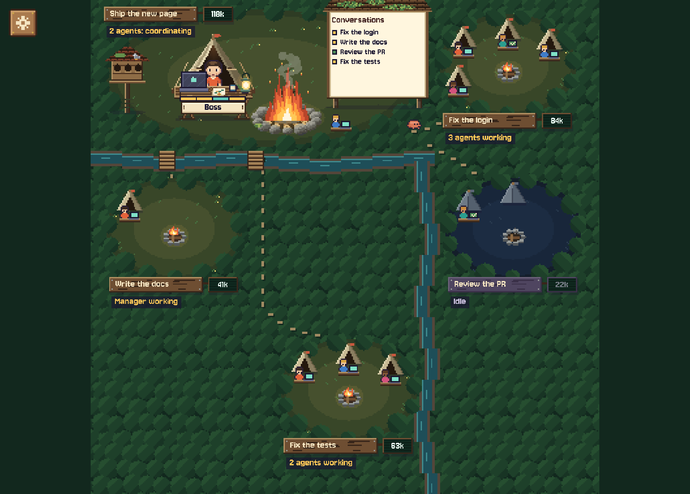
</p>

### Futuriste

<p align="center">
  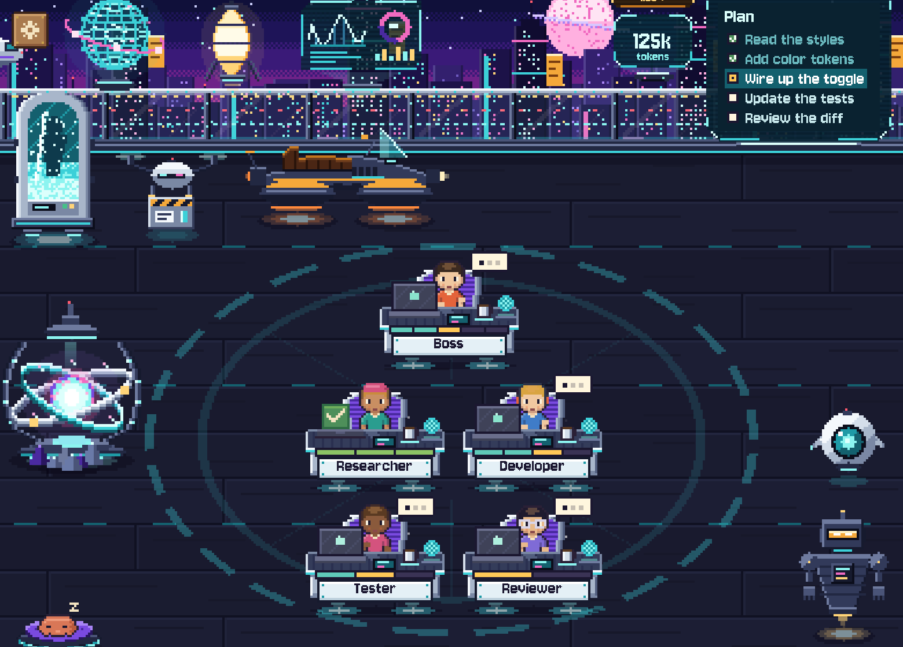
  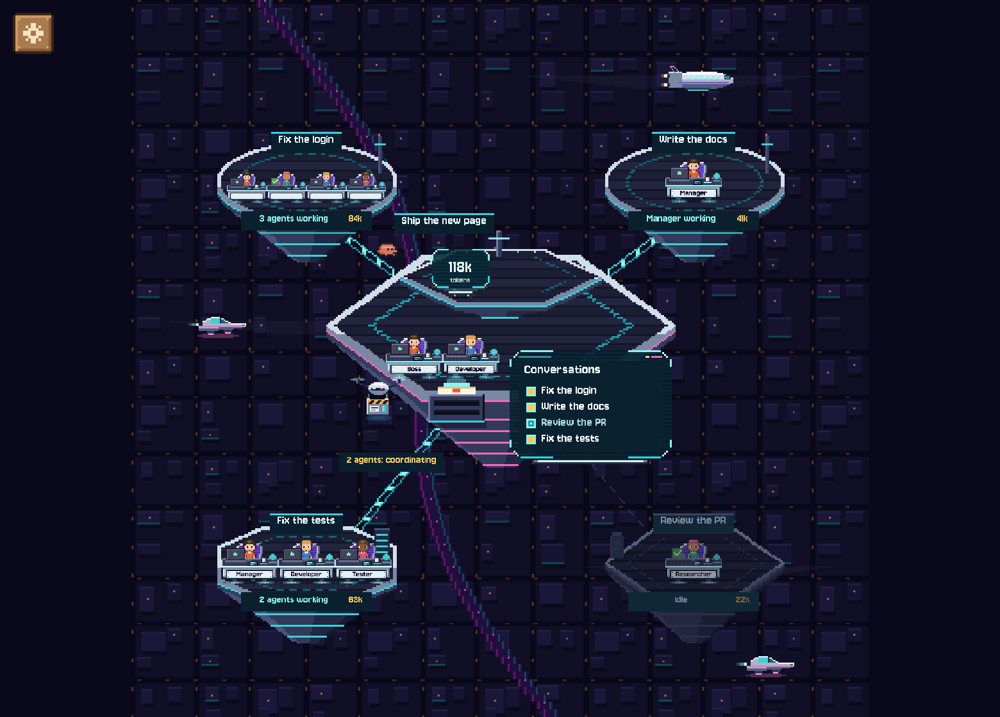
</p>

### Geek et jeu

<p align="center">
  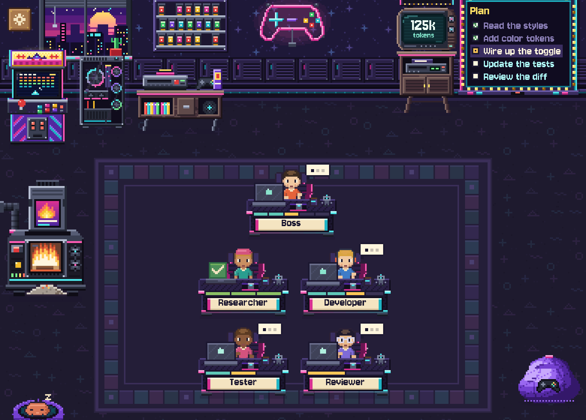
  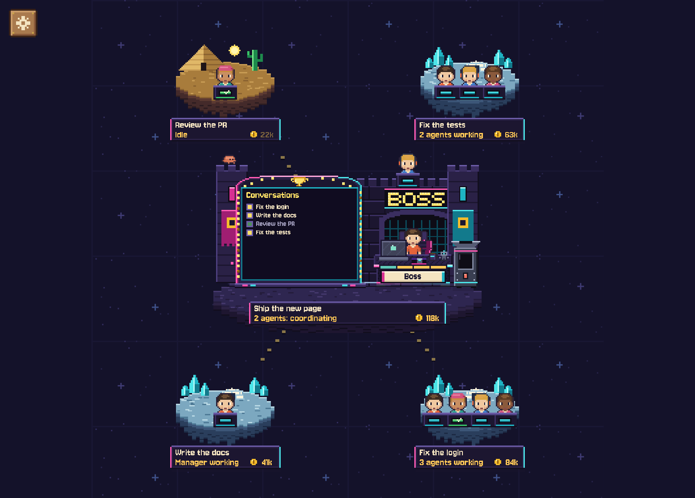
</p>

### Base spatiale

<p align="center">
  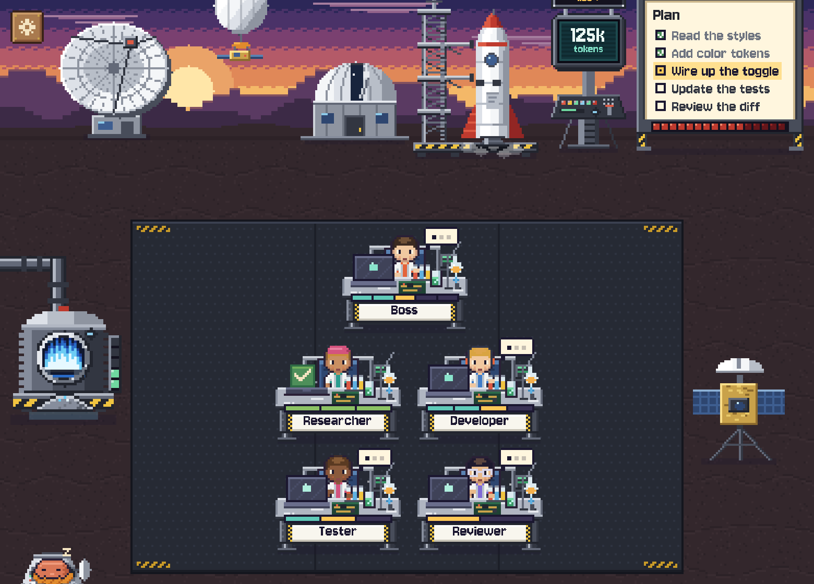
  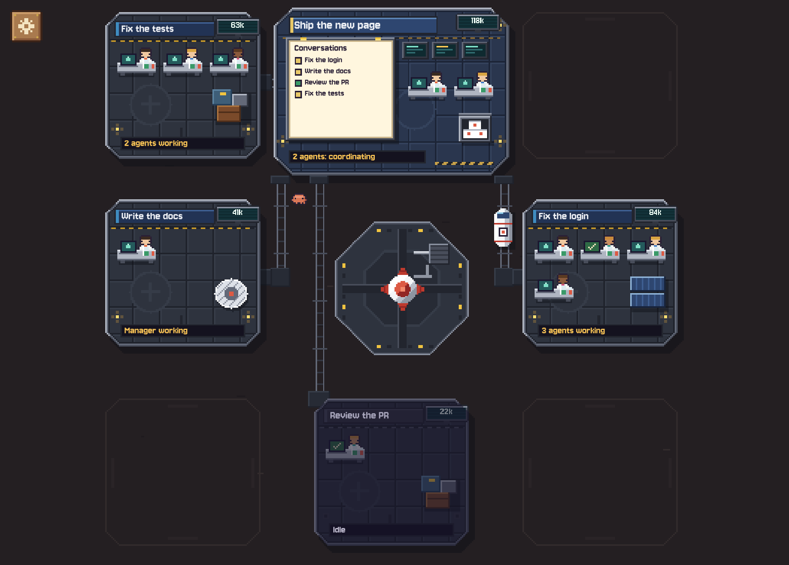
</p>

## Tout se règle dans les Réglages

Les Réglages s'ouvrent avec le bouton sur le mur de la pièce. Ton choix vaut pour toutes tes conversations.

| Réglage | Ce que tu choisis |
| --- | --- |
| **Thème** | L'un des six thèmes. |
| **Départ des bureaux** | Les agents finis partent à la fin du plan, ou un par un. |
| **Cache** | Les relances, actives ou coupées. |
| **Briefing** | Automatique ou Manuel. |
| **Curseur du mode Automatique** | De 0 à 3 compactages avant de changer de conversation, ou Toujours pour compacter sans jamais changer. |

En mode Manuel, le mod ne compacte plus et ne change plus de conversation tout seul. Un bouton apparaît sur la cheminée, et rien ne bouge tant que tu ne cliques pas.

## À savoir avant d'installer

<details>
<summary><b>Les limites des relances</b></summary>

<br>

Une relance envoie une seule ligne, `Answer only: ok`, par-dessus ton contexte en cache. Une conversation plus grosse a plus à relire. Chaque relance est notée dans `~/.claude/pixeldesk/logs/pixeldesk.log`, avec les tokens lus et écrits.

- **Conversation inactive.** 30 relances ou 2 heures au plus, puis le feu s'éteint.
- **Conversation au travail.** Tant qu'un tour, un agent ou une sous-conversation tourne, pas de plafond.
- **Étape de plan en cours.** Elle ne compte comme du travail que 15 minutes après la dernière activité.
- **Plusieurs conversations.** Chacune compte pour elle-même, et elles s'additionnent.
- **Durée de cache inconnue.** Aucune relance tant que tes messages ne l'ont pas prouvée.
- **Cache déjà expiré.** Le mod ne le relance jamais : ce serait le plus cher, pour rien.
- **Échecs.** Trois de suite arrêtent les relances jusqu'à ton prochain message.

</details>

<details>
<summary><b>Le changement de conversation</b></summary>

<br>

- **Des tokens aussi.** Écrire un briefing, compacter et démarrer la nouvelle conversation consomment tes limites.
- **Il faut la commande `claude`.** Sans elle, ou sous Linux, le texte attend dans la nouvelle conversation et tu appuies sur Entrée.
- **Cache déjà expiré.** Le mod te demande avant de compacter ou de changer.
- **En clair sur ton disque.** Les briefings sont écrits dans `~/.claude/pixeldesk/briefings/`, avec les notes de compactage. Les 20 derniers sont gardés. Les formats de secrets connus sont retirés, mais relis un fichier avant de le partager.

</details>

<details>
<summary><b>La version terminal</b></summary>

<br>

Dans une session terminal, PixelDesk Mod s'affiche en texte : une barre en caractères et une liste d'agents. Le pixel art reste dans l'application de bureau.

Les relances y tournent aussi, sans la cheminée.

Il n'y a pas de mur à cliquer. Pour passer en Manuel, mets `"briefingMode": "manual"` dans `~/.claude/pixeldesk/settings.json`.

</details>

<details>
<summary><b>Compatibilité, fichiers et confidentialité</b></summary>

<br>

- **Testé** sous Windows seulement pour l'instant, avec Claude Code 2.1.309. Les retours macOS et Linux sont les bienvenus.
- **Patron et Manager.** Il n'y a qu'un Patron, ta conversation principale. Les conversations qu'elle lance sont des Managers. Les liens de l'application ne sont lus que sous Windows : ailleurs, une sous-conversation s'affiche aussi Patron.
- **Langue.** Le mod suit le réglage `language` de Claude Code, puis la langue du système, et se rabat sur l'anglais. Pour en imposer une, utilise l'option `language` du plugin : `auto`, `fr` ou `en`.
- **Tes fichiers.** Le mod écrit dans `~/.claude/pixeldesk/`, et nulle part ailleurs.
- **Limites.** Les jauges affichent `--` tant que Claude Code n'a pas donné de relevé.
- **Vue globale.** Sous Windows, il lit les liens entre conversations dans l'application. Ailleurs, il regroupe les conversations du même projet.
- **Consommation.** Pour garder la barre à jour, le mod ajoute une courte instruction au prompt de Claude, une note à chaque sous-agent à son premier appel d'outil, et un court rappel après certains appels d'outils. Tant que le panneau est ouvert, les résumés des bureaux viennent de petits appels à Haiku.
- **Limite connue.** Un plugin ne peut pas retirer la marge intérieure du panneau ni sa gouttière de défilement.

</details>

## Ce que PixelDesk Mod lit, écrit, lance et envoie

PixelDesk Mod est un plugin avec un module de hooks : il tourne avec tes droits d'utilisateur. Cette section liste tout ce qu'il fait sur ta machine. Le code est dans `hooks/`, lisible et non minifié. Chaque appel à Claude Code est écrit en clair dans le hook `session.start` de `hooks/register.tsx`, et le reste du mod passe par lui. Les fichiers de test n'utilisent que des valeurs fictives.

### En bref

- **Pas de serveur, pas de compte, pas d'analytics, pas de télémétrie.** Le mod ne fait aucun appel réseau de son côté.
- **Les appels au modèle** passent par Claude Code vers Anthropic, sur ton propre compte. Ils comptent dans tes limites.
- **Aucun identifiant.** Le mod ne lit ni clé d'API ni jeton de connexion, et il n'en demande aucun.
- **Aucune décision de permission.** Il n'autorise, ne refuse et ne réécrit jamais l'appel d'un autre outil. Il laisse les sous-agents et les réglages tels quels.

### Ce qu'il lit

| Quoi | Pourquoi |
| --- | --- |
| La conversation en cours, via Claude Code | Pour écrire les passations et les notes de compaction. Elles peuvent contenir tout ce que tu as écrit. |
| Le transcript de la session dans `~/.claude/projects/`, jusqu'à 4 Mio, au plus toutes les 5 minutes | Uniquement pour trouver la durée du cache. |
| Les noms et les entrées des outils que Claude utilise | Pour animer les bureaux, le plan et les cartes d'agents. |
| L'usage et les limites donnés par Claude Code | Pour les jauges et la plaque du coût. |
| Le réglage `language` de Claude Code, puis ta locale et celle du système | Pour choisir la langue. |
| Sous Windows, les fichiers de session `local_*.json` de l'app, dans `%LOCALAPPDATA%\Claude-Data\`, au plus une fois par minute | Pour la vue globale. Il garde les identifiants de session, les titres, la marque d'archive et le lien entre conversations. |
| `~/.claude/pixeldesk/` | Ses propres fichiers. |
| Les variables d'environnement `USERPROFILE`, `HOME`, `LOCALAPPDATA`, `LC_ALL`, `LC_MESSAGES`, `LANG`, `LANGUAGE` | Pour trouver tes dossiers et ta langue. |

### Ce qu'il écrit

Tout va dans `~/.claude/pixeldesk/`, et nulle part ailleurs.

| Fichier | Contenu |
| --- | --- |
| `settings.json` | Tes réglages. |
| `state/` | Plan, bureaux et état du cache de chaque conversation. |
| `briefings/` | Passations, notes de compaction et brouillons, en texte brut. Les 20 dernières de chaque sorte sont gardées, les plus anciennes sont vidées. Les formats de secrets connus sont retirés avant. |
| `logs/pixeldesk.log` | Le journal, plafonné à 256 Kio. |

Le mod ne touche ni à tes réglages, ni à ton `CLAUDE.md`, ni à tes hooks, ni aux fichiers de tes projets. Il n'écrit rien qu'un outil exécute.

Une passation est suivie par un modèle : la nouvelle conversation la reçoit dans son premier message et reprend le travail à partir d'elle. Une passation vient de ta conversation, alors relis-la si cette conversation contenait un texte dont tu te méfies. Une passation très longue est coupée, et le message dit quel fichier contient la suite.

### Ce qu'il lance

Chaque programme démarre avec ses arguments en liste, sans shell.

| Programme | Quand | Pourquoi |
| --- | --- | --- |
| `claude -p <passation> --session-id <id> --name=<titre> --tools= --strict-mcp-config` | À chaque changement de conversation, sous Windows et macOS | Démarre la nouvelle conversation dans le dossier de la session, avec le titre de la passation. Le message contient la passation, demande une confirmation en une phrase et dit de ne rien faire d'autre. Cette première réponse n'a ni outils ni connecteurs, quelles que soient tes règles de permission : elle ne peut rien écrire ni lancer, et n'attend jamais de réponse à une demande. Tes outils reviennent à l'ouverture de la conversation. Il consomme tes limites. |
| `rundll32 url.dll,FileProtocolHandler`, `open` ou `xdg-open` | À un changement de conversation, ou quand tu ouvres une passation | Confie un lien `claude://` ou un fichier de passation à ton système. Le lien de nouvelle conversation contient la passation, jusqu'à environ 14 000 caractères, et le dossier. |

Le mod lance aussi une commande de Claude Code tout seul : `/compact`, avec ses propres instructions, quand le contexte atteint ton seuil et que l'app n'offre pas d'autre moyen de compacter. Les Réglages permettent de choisir Manuel : il t'attend alors.

### Ce qu'il envoie, et ce qu'il fait tout seul

Tout passe par Claude Code vers Anthropic. Rien ne part ailleurs.

| Appel | Quand | Ce qui part |
| --- | --- | --- |
| Relance du cache | Activée par défaut, 45 secondes avant l'expiration du cache | Ta conversation, lue depuis le cache, plus la ligne `Answer only: ok`. |
| Passation | À un changement de conversation | Ta conversation, avec une demande d'écrire la passation. |
| Compaction | À 80 % du contexte par défaut | Ta conversation, avec des instructions de compaction. |
| Résumé d'agent | Tant que le panneau est ouvert, un appel Haiku toutes les 45 secondes au plus par agent au travail, 120 tokens au plus | La tâche de l'agent et ses 12 dernières étapes. |

Pour arrêter les relances, utilise le réglage Cache ou `/pixeldesk fire off`. Pour décider toi-même de chaque changement de conversation, choisis Manuel dans les Réglages.

### Ce qu'il ajoute à Claude

- **Outils et commande.** Les outils `plan` et `move`, et la commande `/pixeldesk`.
- **Prompt système.** Une courte section demande à Claude de tenir le plan à jour.
- **Résultats d'outils.** Un court rappel après certains appels d'outils. Chaque sous-agent reçoit une note sur son plan avec le résultat de son premier appel.
- **Prompts des sous-agents.** Inchangés. Le mod transmet chaque lancement tel quel, et n'en lit que la description et le type.
- **Hooks.** Le mod suit les sessions, les tours, les appels d'outils, les compactions et les messages pour garder l'affichage à jour. Il ne répond que pour ses propres outils et sa propre commande.

### Exemples

- *« Refactorise le module de connexion et teste-le. »* Chaque agent a son bureau, et le plan se remplit au mur.
- *« Continue pendant mon absence. »* Le cache reste valide et le feu montre pour combien de temps.
- *`/pixeldesk move`.* Le mod écrit une passation et ouvre une nouvelle conversation qui l'a lue.

Questions, bugs ou signalements de sécurité : [ouvre une issue](https://github.com/Mats-TH/pixeldesk-mod/issues).

## Commandes

| Commande | Ce qu'elle fait |
| --- | --- |
| `/pixeldesk` | Ouvre le panneau. |
| `/pixeldesk theme <nom>` | Change le thème : `cosy`, `japonais`, `nature`, `futuriste`, `geek` ou `base`. |
| `/pixeldesk fire off` | Coupe les relances, dans toutes les conversations. `on` les réactive. |
| `/pixeldesk fire` | Dit où en sont les relances. |
| `/pixeldesk move` | Écrit un briefing maintenant, ou dès que le travail en cours est fini. |
| `/pixeldesk compact` | Compacte maintenant, une fois le tour fini. |

<details>
<summary><b>Toutes les commandes</b></summary>

<br>

| Commande | Ce qu'elle fait |
| --- | --- |
| `/pixeldesk` | Ouvre le panneau, et cesse de le masquer s'il l'était. |
| `/pixeldesk hide` | Ferme le panneau partout et l'empêche de s'ouvrir seul. La barre, le suivi et les relances continuent. |
| `/pixeldesk show` | Ouvre le panneau ici et le laisse de nouveau s'ouvrir seul. |
| `/pixeldesk theme` | Dit le thème actuel et les noms disponibles. |
| `/pixeldesk theme <nom>` | Change le thème, dans toutes les conversations. |
| `/pixeldesk departure` | Dit quand partent les bureaux finis. |
| `/pixeldesk departure plan` | Les bureaux finis restent jusqu'à la fin du plan, puis partent ensemble. C'est le réglage par défaut. |
| `/pixeldesk departure each` | Chaque bureau part 30 secondes après la fin de son agent. |
| `/pixeldesk fire` | Dit où en sont les relances : actives ou non, temps restant, combien, et pourquoi elles se sont arrêtées. |
| `/pixeldesk fire on` | Active les relances dans toutes les conversations. C'est le réglage par défaut. |
| `/pixeldesk fire off` | Coupe les relances dans toutes les conversations, et rien d'autre. Le feu suit simplement le cache. |
| `/pixeldesk move` | Écrit un briefing maintenant, ou dès que le travail en cours est fini. Clique sur `Nouvelle conversation` quand il est prêt. |
| `/pixeldesk compact` | Compacte maintenant, comme le mode Automatique, une fois le tour fini. Cela compte pour le curseur. |

Pour retirer aussi la barre, désactive le plugin avec `/plugin`.

</details>

## Crédits et licence

La police pixel est Jersey 10. Voir [CREDITS.md](CREDITS.md).

MIT. Voir [LICENSE](LICENSE). Gratuit, sans compte, sans télémétrie.

---

<sub>PixelDesk Mod est un projet communautaire. Il n'est ni affilié à Anthropic ni approuvé par Anthropic. Claude et Claude Code sont des marques d'Anthropic.</sub>
