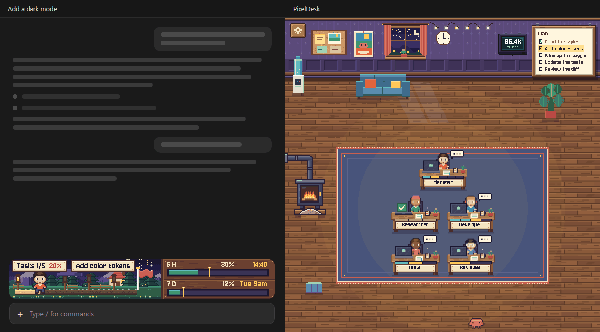

[Read in English](README.md)


**Tes agents Claude Code au travail, dans un petit bureau en pixel art.**

Pensé pour l'application de bureau Claude. C'est là que tu profites de la barre pixel, de la pièce en direct et du plan d'étage.



## Installer dans l'application de bureau

Colle ceci dans n'importe quel terminal :

```
claude plugin install pixeldesk --marketplace Mats-TH/pixeldesk-mod
```

Ouvre ensuite une nouvelle conversation dans l'onglet **Code** de l'application de bureau Claude. C'est tout.

Pas de commande `claude` sur ta machine ? Passe par l'application. Clique sur **+** à côté de la zone de saisie, puis **Plugins**, puis **Add marketplace**. Colle ceci, puis clique sur **Add plugin** :

```
Mats-TH/pixeldesk-mod
```

## À quoi ça sert

Pendant que tu attends, Claude Code abat beaucoup de travail. PixelDesk te le montre.

Ton plan, tes limites d'usage et chaque sous-agent restent à l'écran, en direct, juste à côté du chat.

## Fonctionnalités

- **Barre en pixel art.** 80 px au-dessus de la saisie : ton plan, sa progression, tes limites 5 h et hebdo.
- **Un bureau par sous-agent.** Chaque agent s'installe dans la pièce, en direct. Survole un bureau pour lire sa carte.
- **Ton bureau Manager.** La conversation a son propre bureau, en tête de pièce. Elle travaille pendant un tour et fait la sieste entre deux.
- **Des bureaux bien rangés.** Les bureaux finis partent tout seuls. Choisis quand avec le bouton réglages, sur le mur.
- **Plan d'étage.** Une conversation qui en pilote d'autres les voit toutes d'un coup d'œil, une pièce pour chacune.
- **Outil de plan.** Claude annonce ses étapes avec un outil `plan`, et la barre suit.
- **Français et anglais.** Toute l'interface parle les deux.


## Dans le terminal

PixelDesk tourne aussi dans une session terminal, en version texte plus simple : une barre en caractères et la liste des agents. Le pixel art reste dans l'application de bureau.

Pour l'installer depuis une session terminal ouverte :

```
/plugin install pixeldesk --marketplace Mats-TH/pixeldesk-mod
```

Réponds `y` pour ajouter la marketplace, puis choisis un scope.

## Utilisation

Rien à régler. Une fois installé, PixelDesk tourne tout seul.

La barre est toujours là. Le panneau s'ouvre avec la session dans l'application de bureau, et avec ton premier agent dans le terminal.

| Commande | Ce qu'elle fait |
| --- | --- |
| `/pixeldesk` | Ouvre le panneau, et lève le masquage s'il y en avait un. |
| `/pixeldesk hide` | Ferme le panneau dans toutes les conversations et l'empêche de s'ouvrir tout seul. La barre reste et le suivi continue. |
| `/pixeldesk show` | Ouvre le panneau ici et le laisse de nouveau s'ouvrir tout seul. |
| `/pixeldesk departure` | Te dit quand partent les bureaux finis. |
| `/pixeldesk departure plan` | Les bureaux finis restent jusqu'à la fin du plan, puis partent ensemble. C'est le réglage par défaut. |
| `/pixeldesk departure each` | Chaque bureau part 30 secondes après la fin de son agent. |

Pour retirer aussi la barre, désactive le plugin avec `/plugin`.

Dans l'application de bureau, le bouton réglages sur le mur de la pièce fait la même chose que `departure`. Ton choix vaut pour toutes les conversations.

## Langue

PixelDesk choisit sa langue tout seul. Il suit le réglage `language` de Claude Code, puis la langue de ton système, et se rabat sur l'anglais.

Pour en imposer une, utilise l'option `language` : `auto` (par défaut), `fr` ou `en`. Change-la dans les options du plugin, ou fixe-la à l'installation :

```
claude plugin install pixeldesk --marketplace Mats-TH/pixeldesk-mod --config language=fr
```

## Bon à savoir

- **Limite connue.** Un mod ne peut pas retirer la marge intérieure du panneau ni sa gouttière de défilement.
- **Testé sur** Claude Code 2.1.309, Windows. Il faut une version récente de Claude Code, qui charge les modules de hooks.
- **Tes fichiers.** Le mod écrit dans `~/.claude/pixeldesk/`. Une exception : sous Windows, si aucune langue n'est réglée nulle part, il demande une fois la langue du système à PowerShell et la garde dans le stockage des plugins de Claude Code.
- **Limites.** Les jauges affichent `--` tant que Claude Code n'a rien transmis.
- **Plan d'étage.** Sous Windows, il lit les liens entre conversations dans l'application de bureau. Ailleurs, il regroupe les conversations d'un même projet.
- **Consommation.** Pour tenir la barre à jour, PixelDesk ajoute une courte consigne au prompt de Claude et à celui de chaque sous-agent, plus un court rappel après certains appels d'outils. Panneau ouvert, les résumés en langage simple des bureaux viennent de petits appels à Haiku.

## Crédits

La police pixel est Jersey 10. Voir [CREDITS.md](CREDITS.md).

## Licence

MIT. Voir [LICENSE](LICENSE).

---

PixelDesk est un projet communautaire, non affilié à Anthropic et non approuvé par Anthropic. Claude et Claude Code sont des marques d'Anthropic.
