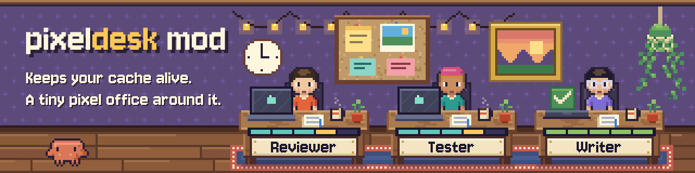
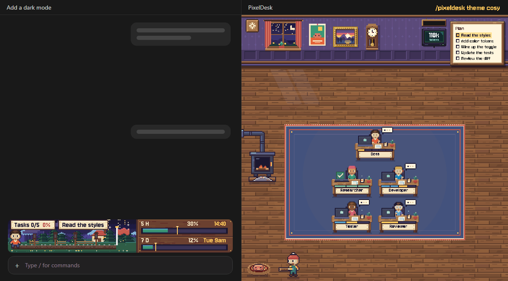
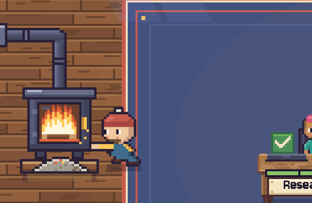
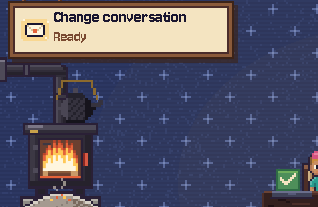
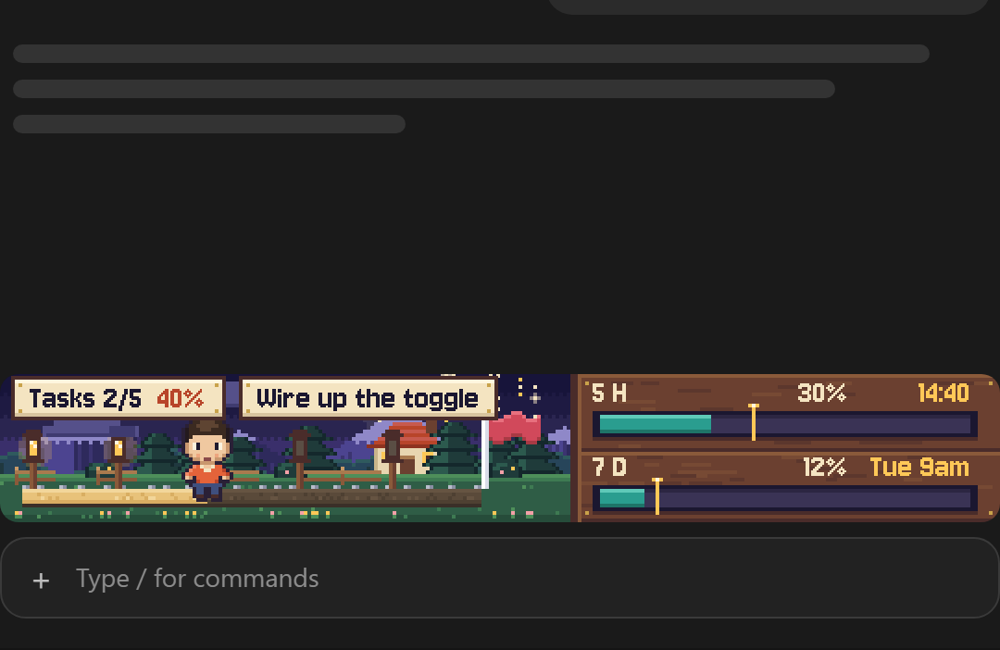
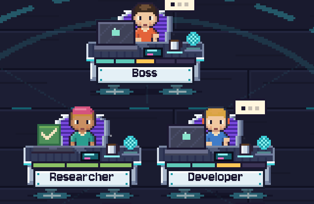
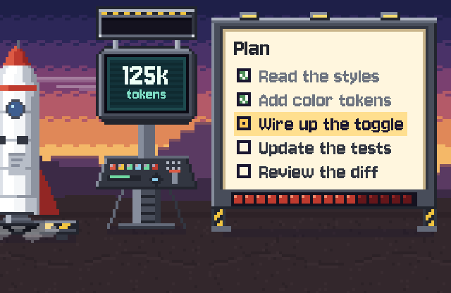
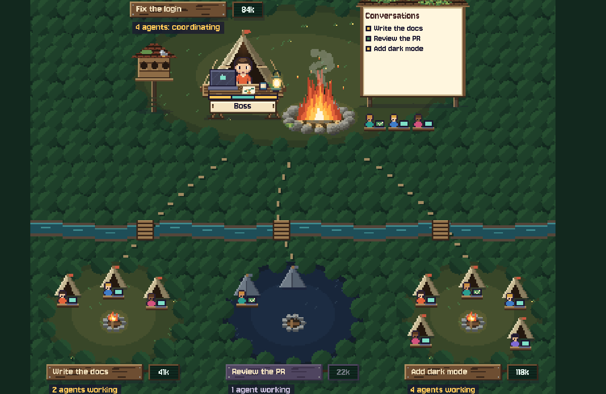
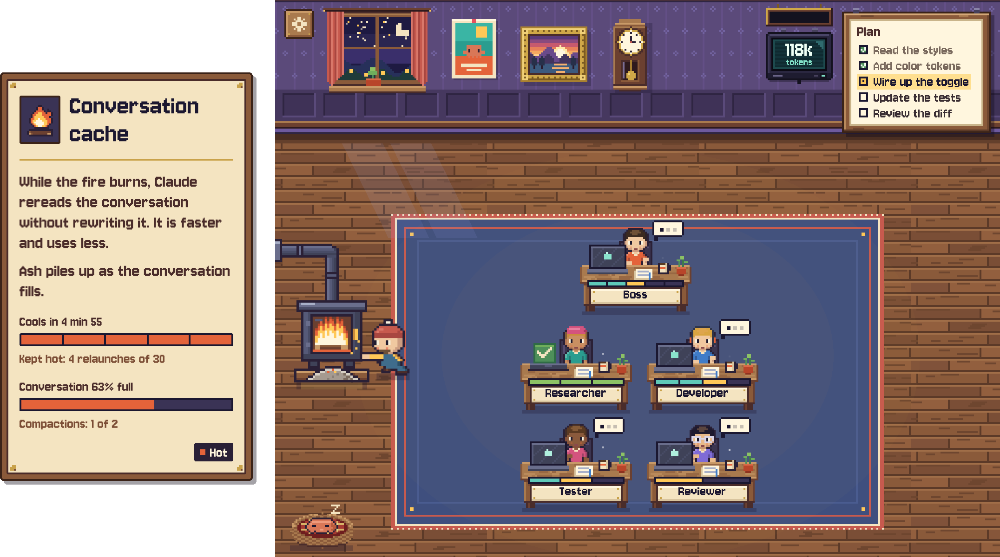
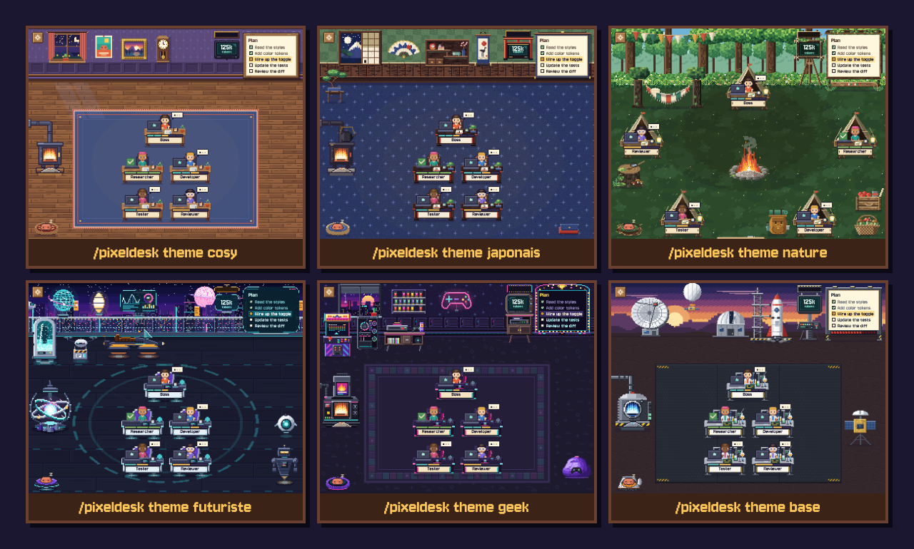

<p align="center"><a href="README.fr.md">Lire en français</a></p>

<p align="center">
  
</p>

<h3 align="center">Spend fewer tokens in Claude Code, and see everything it does.</h3>

<p align="center">
  
  
  
  
</p>

<p align="center">
  <a href="#install"><b>Install</b></a> &nbsp;·&nbsp;
  <a href="#built-to-save-tokens"><b>Save tokens</b></a> &nbsp;·&nbsp;
  <a href="#what-you-get"><b>Features</b></a> &nbsp;·&nbsp;
  <a href="#six-rooms-one-command"><b>Themes</b></a> &nbsp;·&nbsp;
  <a href="#commands"><b>Commands</b></a>
</p>

<p align="center">
  
</p>

<p align="center"><sub>A mock-up, drawn by the mod's own code. The bar, the room and the keeper are the real art.</sub></p>

PixelDesk Mod is a free plugin for the Claude desktop app.

It keeps your cache alive while you're away, and moves you to a fresh conversation before this one fills up. All of it runs in a tiny pixel office next to the chat.

It looks nice. That's not the point. The point is to stop paying to rebuild the same conversation.

## Install

**In the Claude desktop app, open the Code tab and paste this into the conversation:**

```
Install the PixelDesk Mod plugin. Run: claude plugin install pixeldesk --marketplace Mats-TH/pixeldesk-mod (if claude is not found, use the path in the CLAUDE_CODE_EXECPATH environment variable instead).
```

Use the copy button: the line runs past the edge of the box. Claude runs the command for you. Allow it when asked.

Then open a new conversation in the Code tab. That's it.

| Where you are | What to do |
| --- | --- |
| **Code tab of the desktop app** | Paste the line above. No terminal needed. |
| **A normal chat** | It can't install a mod. A chat doesn't run commands on your computer, and the mod lives in the Code tab. Switch to the Code tab, then paste the line. |
| **A terminal** | Run the command below. |

<details>
<summary><b>Other ways to install</b></summary>

<br>

**From any terminal:**

```bash
claude plugin install pixeldesk --marketplace Mats-TH/pixeldesk-mod
```

**From the app's buttons:** click **+** next to the prompt box, then **Plugins**, then **Add marketplace**. Paste `Mats-TH/pixeldesk-mod`, then click **Add plugin**.

**From a running terminal session:**

```
/plugin install pixeldesk --marketplace Mats-TH/pixeldesk-mod
```

Answer `y` to add the marketplace, then choose a scope.

**To force a language:**

```bash
claude plugin install pixeldesk --marketplace Mats-TH/pixeldesk-mod --config language=fr
```

You need Git on your machine: the plugin is fetched from GitHub.

</details>

## Built to save tokens

**Your cache is what makes Claude cheap to come back to.**

Claude keeps your conversation in a cache, for 5 minutes or 1 hour. While it lives, reading it back costs [a fraction of the normal price](https://platform.claude.com/docs/en/about-claude/pricing#prompt-caching).

Once it expires, your next message pays to read and write everything again. On a long conversation, that hurts.

**PixelDesk Mod watches that clock for you.**

45 seconds before the cache cools, it sends one line, `Answer only: ok`. Claude reads the conversation from the cache, and the clock starts over.

When you come back, your cache is still there.

**It also keeps conversations from getting expensive.**

The fuller the conversation, the more every message has to read. So at 80% of the context, PixelDesk Mod compacts, then moves you to a fresh conversation with a briefing already read.

> **The honest part.** Relaunches use tokens, and they count toward your limits. They pay off when you come back. If you never do, they were spent for nothing.
>
> How much you save depends on the size of your conversation and how you work. We haven't measured it, so we won't quote a number.
>
> **Don't want them? `/pixeldesk fire off`.** It's one command, and it stops relaunches everywhere.

## What you get

<table>
  <tr>
    <td width="33%" valign="top">
      
      <br><b>A cache that stays alive</b>
      <br>Automatic relaunches, just before it cools. The fire shows the time left, and a keeper brings a log.
    </td>
    <td width="33%" valign="top">
      
      <br><b>A fresh conversation, by itself</b>
      <br>Ash shows how full you are. When it's full, the mod compacts, then moves on with a briefing.
    </td>
    <td width="33%" valign="top">
      
      <br><b>Your limits, always in sight</b>
      <br>A bar above the prompt with your plan and your 5-hour and weekly limits, live.
    </td>
  </tr>
  <tr>
    <td width="33%" valign="top">
      
      <br><b>One desk per agent</b>
      <br>Every subagent gets a desk, live. Hover it to read what it's doing. The conversation is the Boss.
    </td>
    <td width="33%" valign="top">
      
      <br><b>A plan you can follow</b>
      <br>Claude announces its steps, and they stay on the wall. Hover a step for its detail and who's on it.
    </td>
    <td width="33%" valign="top">
      
      <br><b>A floor plan</b>
      <br>A conversation that runs others sees them all at a glance, one room each.
    </td>
  </tr>
</table>

### It runs by itself

Nothing to set up. Once installed, it just works.

<table>
  <tr>
    <td><b>Relaunches</b></td>
    <td>Before the cache cools, only while it's worth it. Caps below.</td>
  </tr>
  <tr>
    <td><b>Compaction</b></td>
    <td>At 80% of the context, twice by default. Compactions by Claude Code count too.</td>
  </tr>
  <tr>
    <td><b>New conversation</b></td>
    <td>In the same folder, worktree included, with its first message already sent.</td>
  </tr>
  <tr>
    <td><b>Waiting for agents</b></td>
    <td>Agents finish first, so their results land in the briefing.</td>
  </tr>
  <tr>
    <td><b>Your notes</b></td>
    <td>Files, decisions and requests are saved before each compaction, so a briefing never sums up a summary.</td>
  </tr>
</table>

Prefer to decide? Pick **Manual** in the settings. Nothing moves until you click.

### And the little things

- **Hover the fire** for the time left, the relaunches and the exact percentage.
- **Tidy desks.** Finished desks leave on their own, at the end of the plan or one by one.
- **Tokens and cost** on the wall of every room.
- **A settings panel** behind the button on the wall, for everything.
- **A crab.** He lives there. He naps.
- **French and English.** The whole interface speaks both, and picks by itself.
- **A terminal version.** A simpler text bar and a list of agents. Relaunches run there too.

<p align="center">
  
</p>

## Six rooms, one command

<p align="center">
  
</p>

**Cosy, Japanese, Nature, Futuristic, Geek and games, Space base.** Each one has its own furniture, its own stove and its own floor plan.

Pick one in the settings, or type:

```
/pixeldesk theme nature
```

The names are `cosy`, `japonais`, `nature`, `futuriste`, `geek` and `base`.

## Commands

| Command | What it does |
| --- | --- |
| `/pixeldesk` | Opens the panel. |
| `/pixeldesk theme <name>` | Changes the room. |
| `/pixeldesk fire off` | Stops relaunches, in every conversation. `on` starts them again. |
| `/pixeldesk fire` | Tells you where relaunches stand. |
| `/pixeldesk move` | Writes a briefing now, or once the running work is done. |
| `/pixeldesk compact` | Compacts now, once the turn is over. |

<details>
<summary><b>All the commands</b></summary>

<br>

| Command | What it does |
| --- | --- |
| `/pixeldesk` | Opens the panel, and stops hiding it if it was hidden. |
| `/pixeldesk hide` | Closes the panel in every conversation and stops it opening by itself. The bar stays. Tracking, relaunches and the automatic change keep running. |
| `/pixeldesk show` | Opens the panel here and lets it open by itself again. |
| `/pixeldesk theme` | Tells you the current theme and the names. |
| `/pixeldesk theme <name>` | Changes the theme, in every conversation. |
| `/pixeldesk departure` | Tells you when finished desks leave. |
| `/pixeldesk departure plan` | Finished desks stay until the plan ends, then leave together. This is the default. |
| `/pixeldesk departure each` | Each desk leaves 30 seconds after its agent finishes. |
| `/pixeldesk fire` | Tells you where the relaunches stand: on or off, time left, how many, and why they stopped. |
| `/pixeldesk fire on` | Turns relaunches on in every conversation. This is the default. |
| `/pixeldesk fire off` | Turns relaunches off in every conversation, and nothing else. The fire just follows the cache. |
| `/pixeldesk move` | Writes a briefing now, or as soon as the running work is done. Click `New conversation` when it is ready. |
| `/pixeldesk compact` | Compacts now, like Automatic mode does, once the turn is over. It counts toward the slider. |

To remove the bar too, turn the plugin off with `/plugin`.

</details>

## Good to know

<details>
<summary><b>What relaunches cost, and their limits</b></summary>

<br>

**Each relaunch sends one line, `Answer only: ok`, on top of your cached context. It uses tokens, and it counts toward your limits.**

A bigger conversation has more to read. Every relaunch is written to `~/.claude/pixeldesk/logs/pixeldesk.log`, with the tokens it read and wrote.

- **Idle conversation.** 30 relaunches or 2 hours at most once it goes quiet, then the fire goes out.
- **Conversation at work.** While a turn, an agent or a floor conversation is running, it stays hot with no cap.
- **Plan steps.** A step in progress only counts as work for 15 minutes after the last activity.
- **Several conversations.** Each one counts on its own. There is no shared cap, so they add up.
- **Unknown cache length.** No relaunch at all. Your normal turns prove the length, for free.
- **Cold cache.** PixelDesk Mod never relaunches a cache its clock says is cold. That would cost the most and save nothing.
- **Failures.** Three in a row stop relaunches until your next turn.

`/pixeldesk hide` only closes the panel: relaunches keep running.

</details>

<details>
<summary><b>The automatic change of conversation</b></summary>

<br>

When the ash is full, PixelDesk Mod waits for the end of the turn. Then it compacts, or it changes conversation.

In Automatic mode, a slider in the settings decides:

- **0.** It changes conversation straight away.
- **1, 2 or 3.** It compacts that many times, then changes. The default is 2.
- **Always.** It only compacts, and never changes.

In a hurry? `Change now` stays available.

In Manual mode, a `Change` button appears on the fireplace once the ash is full. Once the briefing is ready, click `New conversation`.

- **Tokens.** Writing a briefing, compacting and starting the new conversation all use your limits.
- **It needs the `claude` command.** Without it, or on Linux, the text is ready in the new conversation and you press Enter.
- **Cold cache.** If the cache has already gone cold when the ash fills up, PixelDesk Mod asks you first.
- **In plain text.** Briefings are written in the clear in `~/.claude/pixeldesk/briefings/`, with the compaction notes. The latest 20 of each are kept. Known secret formats are removed, but check a file before you share it.

</details>

<details>
<summary><b>The terminal version</b></summary>

<br>

PixelDesk Mod also runs in a terminal session, as a simpler text version: a bar drawn in characters and a list of agents. The pixel art stays in the desktop app.

Cache relaunches run there too, without the fireplace. `/pixeldesk fire off` works the same.

There is no wall to click in the terminal. To go Manual, set `"briefingMode": "manual"` in `~/.claude/pixeldesk/settings.json`.

</details>

<details>
<summary><b>The rest</b></summary>

<br>

- **Tested on** Windows only so far, with Claude Code 2.1.309. Reports from macOS and Linux are very welcome.
- **Language.** It follows your Claude Code `language` setting, then your system language, and falls back to English. To force one, use the `language` option: `auto`, `fr` or `en`.
- **Your files.** PixelDesk Mod writes in `~/.claude/pixeldesk/`. One exception: on Windows, when no language is set anywhere, it asks PowerShell once for your system language and keeps it in Claude Code's plugin storage.
- **Limits.** The gauges show `--` until Claude Code reports a reading.
- **Floor plan.** On Windows, it reads the links between conversations from the desktop app. Elsewhere, it groups the conversations of the same project.
- **Usage.** To keep the bar up to date, PixelDesk Mod adds a short instruction to Claude's prompt and to each subagent's, plus a short reminder after some tool calls. While the panel is open, the plain-language desk summaries come from small Haiku calls.
- **Known limit.** A plugin cannot remove the panel's inner margin or its scroll gutter.

</details>

## Credits and license

The pixel font is Jersey 10. See [CREDITS.md](CREDITS.md).

MIT. See [LICENSE](LICENSE). Free, no account, no telemetry.

---

<sub>PixelDesk Mod is a community project. It is not affiliated with or endorsed by Anthropic. Claude and Claude Code are trademarks of Anthropic.</sub>
